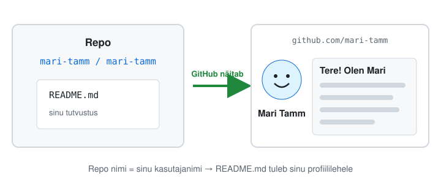
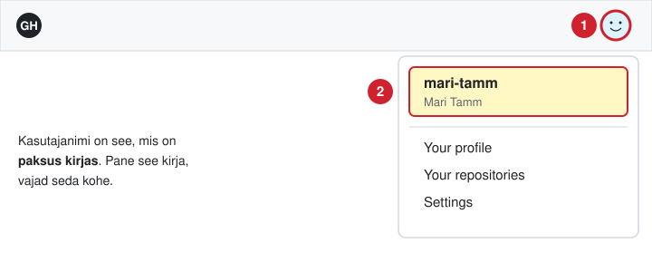
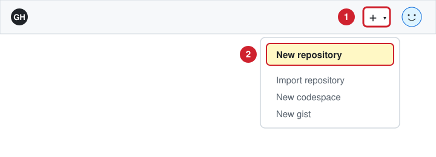
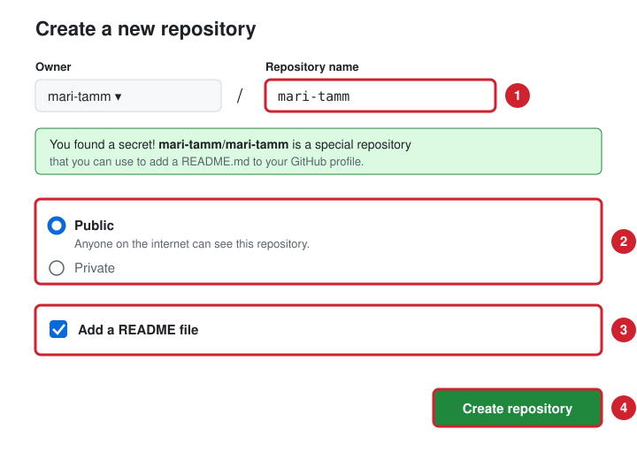
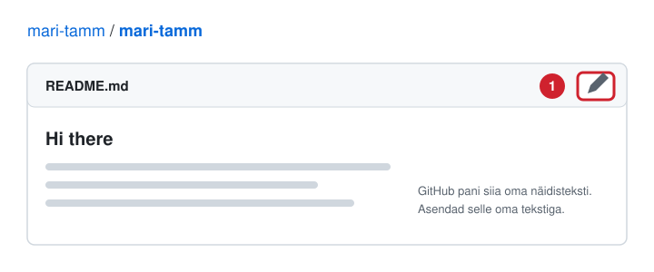
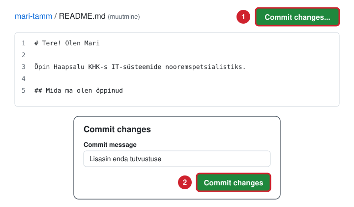
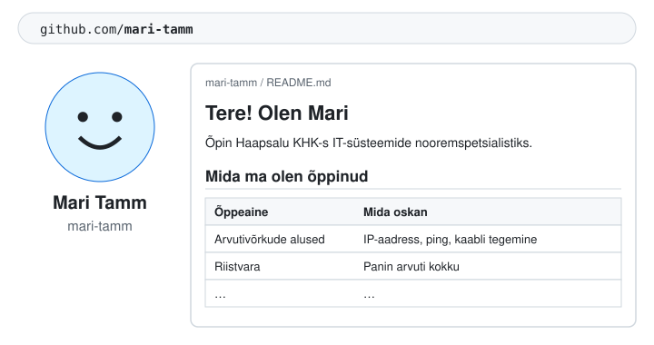
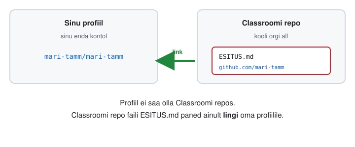

# Minu GitHubi profiil

Teed endale GitHubi profiili: lühike tutvustus sinust ja see, mida oled koolis õppinud. Kõik käib brauseris, midagi ei pea paigaldama.

**Vajad:** GitHubi kontot. Kui seda pole, tee see aadressil <https://github.com/signup>.



---

## Vaata enne näiteid

Ava paar profiili ja vali üks idee, mida tahad enda omas kasutada.

| Profiil | Mis seal on |
|---|---|
| [mariahkhk](https://github.com/mariahkhk) | sinu õpetaja: lihtne ja selge |
| [simonw](https://github.com/simonw) | uuendab end ise, näitab viimaseid töid |
| [thmsgbrt](https://github.com/thmsgbrt) | näitab iga päev ilma |
| [DenverCoder1](https://github.com/DenverCoder1) | värviline, palju märke ja statistikat |
| [abhisheknaiidu](https://github.com/abhisheknaiidu) | mänguline, palju pilte |
| [JessicaLim8](https://github.com/JessicaLim8) | lühike, aga isikupärane |
| [MartinHeinz](https://github.com/MartinHeinz) | üks populaarsemaid profiile |
| [zumrudu-anka](https://github.com/zumrudu-anka) | palju animatsioone ja pilte |

Veel sadu näiteid: [awesome-github-profile-readme](https://github.com/abhisheknaiidu/awesome-github-profile-readme).

> Alusta lihtsast. Ilu saad hiljem juurde lisada.

---

## Samm 1. Leia oma kasutajanimi

Logi sisse aadressil <https://github.com>. Vajuta paremal üleval oma pildile. **Paksus kirjas** on sinu kasutajanimi. Kirjuta see üles.



---

## Samm 2. Tee uus repo

Vajuta paremal üleval **+** ja vali **New repository**.



---

## Samm 3. Pane repole nimi

1. **Repository name:** kirjuta oma kasutajanimi täpselt samamoodi. Kui nimi on õige, ilmub roheline kast *✨ You found a secret! ✨*.
2. Vali **Public**.
3. Pane linnuke kasti **Add a README file**.
4. Vajuta **Create repository**.



---

## Samm 4. Ava README muutmiseks

Vajuta README kohal paremal **pliiatsit** ✏️. Kustuta kogu näidistekst ära.



---

## Samm 5. Kirjuta oma tutvustus

Kopeeri see mall ja kleebi README-sse. Asenda `[ ]` kohad oma tekstiga.

```markdown
# Tere! Olen [eesnimi] 👋

Õpin Haapsalu Kutsehariduskeskuses [eriala nimi].

## Minust

- Mind huvitab [mis sind IT-s huvitab]
- Vabal ajal [hobi]

## Mida ma olen õppinud

| Õppeaine | Mida oskan |
|---|---|
| [aine nimi] | [1–2 asja] |
| [aine nimi] | [1–2 asja] |
| [aine nimi] | [1–2 asja] |
```

Vahelehel **Preview** näed, milline see välja näeb.

> ⚠️ **Profiili näevad kõik.** Ära pane sinna telefoninumbrit, kodust aadressi, sünnikuupäeva ega isikukoodi.

---

## Samm 6. Salvesta

Vajuta **Commit changes...**, kirjuta lühike sõnum (nt `Lisasin enda tutvustuse`) ja vajuta uuesti **Commit changes**.



---

## Samm 7. Vaata oma profiili

Ava `https://github.com/[sinu-kasutajanimi]`. Sinu tutvustus on nüüd profiililehel.



**Ei ilmunud?** Kontrolli, kas repo nimi on täpselt sama mis kasutajanimi ja repo on **Public**.

---

## Samm 8. Esita Classroomis

Ava oma Classroomi repo, vajuta faili `ESITUS.md` juures pliiatsit ✏️, kirjuta sinna link oma profiilile ja vajuta **Commit changes**.



---

## Hiljem

Kui oled mõne aine lõpetanud, ava oma profiilirepo, vajuta pliiatsit ✏️ ja lisa tabelisse uus rida.

### Lisa märgid

Märgid on värvilised sildid, mis näitavad, mis tööriistu oskad. Vali sobivad siit: [markdown-badges](https://github.com/Ileriayo/markdown-badges). Kopeeri märgi rida ja kleebi README-sse.

Näiteks:

```markdown


```

Tuleb välja nii:


### Veel ideid

**Lihtne:** vali, kopeeri, kleebi.

| Mis | Kust |
|---|---|
| Profiili tegemine vormiga, README tuleb ise valmis | [github-profile-readme-maker](https://github.com/VishwaGauravIn/github-profile-readme-maker) |
| Kirjutav animeeritud tekst | [readme-typing-svg](https://github.com/DenverCoder1/readme-typing-svg) |
| Päisepilt oma nimega | [github-profile-header-generator](https://github.com/leviarista/github-profile-header-generator) |
| Liikuvad pildid ja avatarid | [Cool-GIFs-For-GitHub](https://github.com/Anmol-Baranwal/Cool-GIFs-For-GitHub) |
| Veel märke | [Badges4-README.md-Profile](https://github.com/alexandresanlim/Badges4-README.md-Profile) |
| Kõik ühes kohas: vidinad, ikoonid, juhendid | [beautify-github-profile](https://github.com/rzashakeri/beautify-github-profile) |

**Keerulisem:** need vajavad tegevust GitHubis. Uuel kontol on need alguses tühjad.

| Mis | Kust |
|---|---|
| Karikad tegevuse eest | [github-profile-trophy](https://github.com/ryo-ma/github-profile-trophy) |
| Statistika kaardid | [github-profile-summary-cards](https://github.com/vn7n24fzkq/github-profile-summary-cards) |
| Madu, mis sööb sinu tegevusgraafikut | [snk](https://github.com/Platane/snk) (vajab GitHub Actionsit) |

Rohkem: teema [github-profile-readme](https://github.com/topics/github-profile-readme).
